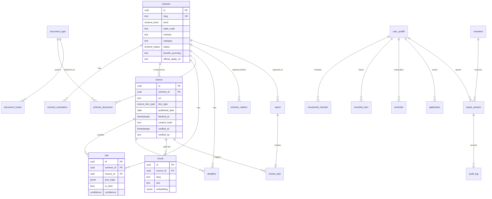

# Data model

> **Status (updated 2026-11-04):** the tables that exist are `report` (Flyway V1); `app_user`, `otp_challenge`, `auth_session`, `user_data`, `guide_message`, `case_share`, `case_note`, `audit_log` (V2); and `push_subscription` (V3): PostgreSQL in production, H2 in PostgreSQL mode locally and in tests. The household, checklist and application tracking are one encrypted JSON document in `user_data`, not the separate tables described below. What the daily re-check finds is in `content/source-status.json` (KNOWLEDGE_BASE §5). Schemes, rules, sources and documents are still files in `content/`, served from the generated bundle. Everything else here is **planned**. Target: PostgreSQL 15+ with `pgvector` (Supabase or Neon). Types below are Postgres types.

## 1. Conventions

- Primary keys are `uuid` (`gen_random_uuid()`), except lookup tables keyed by a short `code`.
- Every table has `created_at timestamptz not null default now()`; mutable tables also have `updated_at`.
- Language codes are the 10 app codes: `en hi bn ta te mr gu kn ml pa`.
- `state_code` is the ISO 3166-2:IN subdivision code without the prefix (e.g. `MH`, `UP`). `null` means central / all-India.
- Enums are Postgres `enum` types (listed in §4).
- **Knowledge tables** (scheme, rule, source, …) are public read for published rows. **User tables** are protected by row-level security and hold coarse data only (see [PRIVACY_AND_SECURITY.md](PRIVACY_AND_SECURITY.md)).

## 2. ER diagram



## 3. Tables

### 3.1 Knowledge base

#### `scheme`
| Column | Type | Notes |
|---|---|---|
| `id` | uuid PK | |
| `slug` | text unique | e.g. `pm-kisan` |
| `level` | `scheme_level` | `central` / `state` |
| `state_code` | text null | required when `level = state` |
| `ministry` | text | issuing ministry or department |
| `category` | text | one of the app categories: `education`, `pension`, `health`, `housing`, `agriculture`, `women_child`, `disability`, `employment`, … |
| `status` | `scheme_status` | `draft` / `published` / `needs_review` / `archived` |
| `benefit_summary` | text | English source text; translations in `scheme_translation` |
| `official_apply_url` | text | official portal only |
| `reverify_days` | int default 180 | re-verification interval |
| `created_at`, `updated_at` | timestamptz | |

#### `scheme_translation`
| Column | Type | Notes |
|---|---|---|
| `scheme_id` | uuid FK → scheme | PK part |
| `lang` | text | PK part |
| `name` | text | |
| `summary` | text | grade-5 reading level |
| `how_to_apply` | text | |
| `machine_translated` | bool | true until a human reviews it |
| `reviewed_by` | text null | reviewer id |
| `reviewed_at` | timestamptz null | |

#### `source`
| Column | Type | Notes |
|---|---|---|
| `id` | uuid PK | |
| `scheme_id` | uuid FK → scheme | |
| `url` | text | canonical official URL |
| `title`, `publisher` | text | |
| `doc_type` | `source_doc_type` | `gazette` / `guideline` / `govt_statement` / `faq` / `portal` / `secondary` |
| `lang` | text | language of the original |
| `published_date` | date null | date on the document |
| `fetched_at` | timestamptz | last successful fetch |
| `content_hash` | text | sha256 of normalised text |
| `verified_at` | timestamptz null | last human verification |
| `verified_by` | text null | reviewer id |
| `archived_copy` | text null | path to the stored snapshot used for review |

#### `rule`
| Column | Type | Notes |
|---|---|---|
| `id` | uuid PK | |
| `scheme_id` | uuid FK → scheme | |
| `code` | text | stable id within the scheme, e.g. `age_min` |
| `json_logic` | jsonb | see [RULES_ENGINE.md](RULES_ENGINE.md) |
| `description_key` | text | i18n key for the human-readable rule |
| `is_hard` | bool | a failing hard rule → "not eligible" |
| `source_id` | uuid FK → source | the clause that justifies it |
| `source_locator` | text null | page / section / paragraph |
| `confidence` | `confidence` | `confirmed` / `guidance` / `uncertain` |
| `version` | int | bumped on change; old versions kept |

#### `scheme_relation`
| Column | Type | Notes |
|---|---|---|
| `scheme_id`, `other_scheme_id` | uuid FK → scheme | |
| `kind` | `relation_kind` | `stacks_with` / `excludes` |
| `source_id` | uuid FK → source | |

#### `document_type` and `document_howto`
| `document_type` | Type | Notes |
|---|---|---|
| `id` | uuid PK | |
| `code` | text unique | e.g. `income_certificate`, `caste_certificate`, `aadhaar` |
| `name_key` | text | i18n key |

| `document_howto` | Type | Notes |
|---|---|---|
| `document_type_id` | uuid FK | |
| `state_code` | text null | null = generic guidance |
| `lang` | text | |
| `office`, `portal_url`, `typical_days`, `steps` | text / text / int / text | |
| `source_id` | uuid FK → source | |

#### `scheme_document`
| Column | Type | Notes |
|---|---|---|
| `scheme_id` | uuid FK | |
| `document_type_id` | uuid FK | |
| `mandatory` | bool | |
| `notes` | text | |
| `source_id` | uuid FK → source | |

#### `deadline`
| Column | Type | Notes |
|---|---|---|
| `id` | uuid PK | |
| `scheme_id` | uuid FK | |
| `state_code` | text null | |
| `opens_at`, `closes_at` | timestamptz null | `closes_at` null = rolling |
| `recurring_rule` | text null | RFC 5545 RRULE for yearly windows |
| `source_id` | uuid FK → source | |

#### `chunk`
| Column | Type | Notes |
|---|---|---|
| `id` | uuid PK | |
| `source_id` | uuid FK → source | |
| `lang` | text | |
| `ordinal` | int | position in the source |
| `locator` | text | page / heading path, for citations |
| `text` | text | 300–500 tokens |
| `embedding` | `vector(1024)` | dimension of the configured embedder (bge-m3 = 1024) |
| `embedding_model` | text | re-embed when it changes |

Index: `hnsw (embedding vector_cosine_ops)`, plus btree on `(source_id)` and `(lang)`.

### 3.2 User side

All optional. The default MVP mode keeps the profile on the device (`localStorage`) and sends coarse bands only when matching. These tables are used only when the user opts in to sync or reminders.

#### `user_profile`
| Column | Type | Notes |
|---|---|---|
| `id` | uuid PK | |
| `lang` | text | |
| `state_code` | text | |
| `district_code` | text null | for nearby help only |
| `age_band` | text | e.g. `18-24`, `60-69` |
| `income_band` | text | e.g. `<1L`, `1-2.5L` |
| `occupation`, `social_category`, `gender` | text null | |
| `disability` | bool null | |
| `is_student` | bool null | |
| `encrypted_blob` | bytea null | any extra fields, encrypted client-side |
| `delete_after` | timestamptz | inactivity expiry |

#### `household_member`
`id`, `profile_id` FK, `relation` (`self`, `spouse`, `child`, `parent`, …), plus the same coarse fields as `user_profile`. No names.

#### `checklist_item`
`profile_id`, `document_type_id`, `status` (`have` / `dont_have` / `unknown`), `updated_at`. **No document numbers.**

#### `reminder`
`id`, `profile_id`, `scheme_id`, `channel` (`webpush` / `telegram`), `channel_ref` (push subscription or Telegram chat id, encrypted), `days_before int[]`, `active bool`.

#### `application`
`id`, `profile_id`, `scheme_id`, `status` (`applied` / `under_review` / `approved` / `rejected`), `rejection_reason` (pick-list code + optional text), `updated_at`.

### 3.3 Volunteer portal (Phase 5)

#### `volunteer`
`id`, `display_name`, `org`, `role` (`volunteer` / `ngo_lead` / `csc_operator`), `verified_by`, `verified_at`, `active`.

#### `assist_session`
| Column | Type | Notes |
|---|---|---|
| `id` | uuid PK | |
| `profile_id` | uuid FK | |
| `volunteer_id` | uuid FK null | set when the code is redeemed |
| `code_hash` | text | short code is never stored in plain text |
| `scope` | text[] | e.g. `{profile.read, checklist.write}` |
| `expires_at` | timestamptz | default 60 minutes |
| `consented_at` | timestamptz | |
| `revoked_at` | timestamptz null | |

#### `audit_log`
Append-only. `id`, `session_id`, `actor` (volunteer id or `user`), `action` (`view` / `update`), `field`, `at`. Stores **which** field was touched, never its value.

### 3.4 Moderation

#### `report`
`id`, `scheme_id`, `source_id` null, `lang`, `reason` (pick-list), `comment` (free text, scanned and stripped of phone/ID-like numbers), `created_at`.

#### `review_task`
`id`, `kind` (`source_changed` / `reverify_due` / `user_report` / `translation_review` / `new_scheme`), `scheme_id`, `source_id` null, `report_id` null, `assignee`, `status` (`open` / `in_progress` / `done` / `dismissed`), `resolution_note`, `created_at`, `closed_at`.

## 4. Enums

```sql
create type scheme_level    as enum ('central', 'state');
create type scheme_status   as enum ('draft', 'published', 'needs_review', 'archived');
create type source_doc_type as enum ('gazette', 'guideline', 'govt_statement', 'faq', 'portal', 'secondary');
create type confidence      as enum ('confirmed', 'guidance', 'uncertain');
create type relation_kind   as enum ('stacks_with', 'excludes');
```

## 5. Integrity rules

- A scheme can be `published` only if it has at least one `source` with `verified_at` set, and every `rule`, `deadline` and `scheme_document` row points to a source of that scheme.
- `secondary` sources can never back a `confirmed` rule.
- Facts are **stale** when `now() - source.verified_at > scheme.reverify_days` or the scheme is `needs_review`. The API returns `stale: true` and the UI shows the warning.
- Deleting a user profile cascades to every user-side table; `audit_log` rows for that user are kept only for the retention period in [PRIVACY_AND_SECURITY.md](PRIVACY_AND_SECURITY.md).
